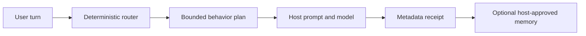

# Humanlike


**Deterministic, provider-neutral behavior controls for conversational AI agents.**

[English](#english) · [Русский](#русский) · [Documentation](#documentation) · [License](#license)

> **Status: public beta (`0.3.1`), licensed under MIT.** The API and configuration schema may change before `1.0`. The core runtime is offline, uses only the Python standard library, and does not call an LLM or the network.



## English

Humanlike is a behavioral planning layer for AI agents. It classifies each turn, selects a social and cognitive mode, assembles bounded guidance, and returns privacy-aware metadata. The host remains responsible for model calls, tools, transport, output delivery, transcript retention, and policy enforcement.

### What's fixed in 0.3.1

- Full multiline second alternatives, including conditions; ambiguous or oversized
  blocks ask for clarification instead of presenting a truncated match.
- Five-version memory pages with `Next memory page`; correction and scoped forget
  use the full lineage, even beyond 50 versions. No SDK coding needed.
- Small full-match RU/EN paraphrases: `Please, usually keep replies short` and
  `Remember: I prefer short replies`. Confirmation is still required.

Live Telegram pilot: **NOT_RUN**. This patch has offline/native-interface checks,
not new model-quality evidence. The previous A/B below remains a tie.

### Native features introduced in 0.3.0

- **Native Hermes setup:** export a runtime-only plugin, enable it, and use `/humanlike` without writing callbacks. Memory is OFF until explicit, single-use confirmation.
- **Small RU/EN memory vocabulary:** save reply-length preferences, inspect sources, correct or forget an unambiguous target, pause, and distinguish no-save from no-recall. Ordinary text proposes; it never authorizes a save.
- **Recent conversation references:** “continue”, “the second version”, “use my last correction” and topic references use bounded authorized history, including actual tool outcomes. No technical anchor names or archive crawling.
- **Real behavioral comparison:** 12 synthetic dialogues, 24 answers and 12 blinded judgments on the same model. Both configurations scored 120/120; **no quality improvement demonstrated**. Enhanced context averaged 1,440 extra characters. See [method and limits](docs/NATIVE_EVALUATION.md).

**Boundaries:** Telegram human DMs support the automatic memory/context path; native CLI offers slash controls only. Explicitly bind each new session with `/humanlike status`. Persistent memory remains POSIX-only, local and unencrypted. Only the documented reply-length vocabulary is extracted; this is not arbitrary personal-fact inference.

Start with [EN/RU setup and controls](docs/HERMES_INSTALL.md). The older [developer API](docs/PERSONAL_MEMORY.md) remains available.

### What it provides

- Deterministic RU/EN routing across cognitive modes and social moves.
- Bounded context plans with mandatory truth and privacy guidance.
- Persona anchoring, repetition control, calibrated stance, and drift signals.
- Optional evidence-aware SQLite memory behind explicit host-controlled consent.
- Opt-in explicit personal-memory capture, correction/forget/revocation controls, and bounded conversation references through an authenticated host API.
- A 40-case offline conformance suite for routing, privacy, context budgets, policy, disclosure, stance, memory, and drift.
- A reference Hermes directory plugin with `pre_llm_call`, `transform_llm_output`, `post_llm_call`, and `on_session_finalize` hooks.
- Stable JSON CLI commands: `route`, `doctor`, `eval`, and `export-plugin`.

### What it is not

Humanlike is not a model, chatbot UI, autonomous agent host, network service, or complete model-safety system. It does not make an AI biologically human, hide AI identity, or control data already copied into a host or provider transcript.

### Quickstart

Requirements: Git and Python 3.11 or newer. Linux and macOS support the complete stack. Native Windows supports the core runtime, CLI, hardened read-only profile loading, read-only conversation references, and the memory-off Hermes plugin. The optional SQLite memory ledger remains POSIX-only in `0.3.x`.

Linux and macOS:

```bash
git clone https://github.com/AlekseiUL/humanlike.git
cd humanlike
python3 -m venv .venv
source .venv/bin/activate
python -m pip install .
```

Native Windows (PowerShell):

```powershell
git clone https://github.com/AlekseiUL/humanlike.git
Set-Location humanlike
py -3.11 -m venv .venv
.\.venv\Scripts\Activate.ps1
python -m pip install .
humanlike eval
humanlike doctor --config examples\hermes-humanlike\humanlike.toml
```

Run the first deterministic route:

```bash
humanlike route --text "Rewrite this paragraph in a neutral tone." --locale en
```

Run the bundled offline conformance suite:

```bash
humanlike eval
```

Validate the included Hermes reference profile:

```bash
chmod -R go-w examples/hermes-humanlike
humanlike doctor --config examples/hermes-humanlike/humanlike.toml
```

The hardened profile loader intentionally rejects group- or world-writable profile files and directories. The `chmod` step keeps the quickstart working in environments whose default `umask` is `0002`.

Each command prints one JSON object. Exit status `0` means success; validation errors use exit status `2`; `humanlike eval` uses exit status `1` when a declared expectation fails.

### Python API

```python
from pathlib import Path

from humanlike_agent import HumanlikeRuntime, Persona, RuntimeConfig, TurnInput

profile = Path("examples/hermes-humanlike").resolve()
persona = Persona.load(profile / "SOUL.md", allowed_root=profile)
runtime = HumanlikeRuntime(RuntimeConfig("example-profile"), persona)

plan = runtime.prepare(
    TurnInput(
        text="Give me three distinct approaches.",
        turn_id="turn-1",
        session_id="session-1",
        locale="en",
    )
)
print(plan.render_context())
```

The host calls its model and reports bounded outcome metadata through `runtime.observe(...)`. See [Architecture](docs/ARCHITECTURE.md) for the full lifecycle and trust boundary.

### Hermes integration

After the package quickstart above, export only the runtime into the selected Hermes home:

```bash
export HERMES_HOME="${HERMES_HOME:-$HOME/.hermes}"
mkdir -p "$HERMES_HOME/plugins"
humanlike export-plugin --output "$HERMES_HOME/plugins/humanlike-agent-kit"
hermes plugins doctor "$HERMES_HOME/plugins/humanlike-agent-kit" --ci
hermes plugins enable humanlike-agent-kit --no-allow-tool-override
hermes plugins show humanlike-agent-kit
```

For a named profile, select its home first. Existing directories are not overwritten.
Start a new Hermes process; do not restart an active gateway without approval.
In a Telegram DM, start an ordinary conversation, then `/humanlike enable memory`
and `/humanlike I agree to local memory`; send the fresh confirmation command
shown in the reply. Only `[enabled]` means consent succeeded. Say “Usually keep
replies short”, confirm the proposal, then ask “What do you remember?”.

See [setup, supported commands and rollback](docs/HERMES_INSTALL.md). No live
installation is implied by the compatibility tests. No extra provider or credentials
are needed. Legacy TOML memory settings and developer APIs remain separate.

### Development

```bash
uv sync --locked --all-extras
uv run pytest -q
uv run ruff check .
uv run python scripts/privacy_gate.py .
```

The installed runtime has no third-party Python dependencies. Development, build, CI, and integration references are documented in [Acknowledgements](ACKNOWLEDGEMENTS.md).

---

## Русский

Humanlike — публичная бета-библиотека под лицензией MIT. Это детерминированный поведенческий слой для ИИ-агентов: он определяет тип запроса и способ ответа, собирает ограниченный контекст и возвращает метаданные с учётом приватности. Вызов модели, инструменты, доставка ответа, хранение переписки и соблюдение политик остаются на стороне основной системы.

### Что исправлено в 0.3.1

- Второй вариант сохраняется целиком: заголовок, текст и условия. При неоднозначности
  или превышении бюджета требуется уточнение, а не обрезанный «найденный» вариант.
- Просмотр памяти по пять версий: `Следующая страница памяти`. Исправление и забывание
  работают со всей цепочкой, в том числе после 50 версий, без Python-кода.
- Небольшой набор точных RU/EN-перефразировок: `Пожалуйста, обычно отвечай кратко`
  и `Запомни: я предпочитаю короткие ответы`. Подтверждение записи сохранено.

Живой Telegram-пилот: **NOT_RUN**. Проверены код и штатные интерфейсы в изоляции;
новых модельных оценок нет. Предыдущий A/B ниже остаётся ничьей.

### Возможности, добавленные в 0.3.0

- **Готовое подключение к Hermes:** экспорт рабочих файлов, штатное включение и `/humanlike` без Python-callbacks. Память выключена до явного одноразового подтверждения.
- **Небольшой RU/EN-словарь:** предпочтения длины ответа, просмотр источников, исправление, забывание, пауза и отдельные no-save/no-recall. Обычная фраза предлагает запись, но не разрешает её.
- **Продолжение разговора:** «продолжи», «второй вариант», «используй мою последнюю поправку» и ссылка на тему используют ограниченную недавнюю историю и реальные результаты инструментов. Технические имена привязок не нужны, архивы не сканируются.
- **Реальное сравнение ответов:** 12 синтетических диалогов, 24 ответа и 12 слепых оценок одной моделью. Обе конфигурации получили 120/120; **улучшение качества не доказано**. Дополнительный контекст — в среднем 1 440 символов. [Метод и ограничения](docs/NATIVE_EVALUATION.md).

**Границы:** автоматическая память и контекст работают в личном Telegram-чате; native CLI предоставляет только команды. Новую сессию нужно привязать через `/humanlike статус`. Постоянная память локальная, POSIX-only, без шифрования. Извлекаются только описанные предпочтения длины ответа, а не любые личные факты.

Начните с [установки и управления EN/RU](docs/HERMES_INSTALL.md). Прежний [API для разработчиков](docs/PERSONAL_MEMORY.md) сохранён.

### Что умеет

- Маршрутизирует русские и английские запросы без вызова модели.
- Формирует ограниченный план ответа с правилами честности и приватности.
- Удерживает персону, снижает повторы, отслеживает позицию и поведенческий дрейф.
- Поддерживает опциональную SQLite-память только с явным согласием основной системы.
- Даёт управляемый захват явно указанных предпочтений, исправление, забывание и ограниченное восстановление контекста через проверенный host API.
- Запускает офлайн-проверку из 40 кейсов.
- Даёт эталонный адаптер для Hermes и JSON CLI-команды `route`, `doctor`, `eval`, `export-plugin`.

### Чего не делает

Это не модель, не интерфейс чата, не автономный агент и не универсальный фильтр безопасности. Kit не скрывает природу ИИ и не может удалить данные, которые уже сохранил хост или провайдер модели.

### Быстрый старт

Нужны Git и Python 3.11 или новее. Linux и macOS поддерживают полный стек. В нативном Windows работают основной runtime, CLI, защищённая загрузка профиля, чтение переданного контекста и Hermes-плагин с выключенной памятью. Опциональная SQLite-память в ветке `0.3.x` остаётся POSIX-only.

Linux и macOS:

```bash
git clone https://github.com/AlekseiUL/humanlike.git
cd humanlike
python3 -m venv .venv
source .venv/bin/activate
python -m pip install .
```

Нативный Windows (PowerShell):

```powershell
git clone https://github.com/AlekseiUL/humanlike.git
Set-Location humanlike
py -3.11 -m venv .venv
.\.venv\Scripts\Activate.ps1
python -m pip install .
humanlike eval
humanlike doctor --config examples\hermes-humanlike\humanlike.toml
```

Проверка одного запроса:

```bash
humanlike route --text "Перепиши этот абзац нейтрально." --locale ru
```

Офлайн-тесты поведения:

```bash
humanlike eval
```

Проверка примера профиля Hermes:

```bash
chmod -R go-w examples/hermes-humanlike
humanlike doctor --config examples/hermes-humanlike/humanlike.toml
```

Защищённый загрузчик намеренно отклоняет файлы и каталоги профиля с правом записи для группы или остальных пользователей. Команда `chmod` нужна в окружениях с `umask 0002`.

Каждая команда печатает один JSON-объект. Код завершения `0` означает успех, `2` — ошибку входных данных или конфигурации, а `humanlike eval` возвращает `1`, если хотя бы одна заявленная проверка не пройдена.

### Интеграция и память

После установки пакета выполните блок **Hermes integration** выше, выбрав home
нужного профиля. Экспорт не перезаписывает старую установку и не меняет Python-среду
Hermes. Запустите новый процесс; живой gateway без согласования не перезапускайте.

В личном Telegram-чате отправьте обычное сообщение, затем `/humanlike включи память`
и `/humanlike согласен на локальную память`. Проверьте запрос и отправьте показанную
одноразовую команду. Только `[enabled]` означает успешное согласие. Далее:
«Обычно отвечай кратко» → подтверждение предложения → «Что ты помнишь?».

[Полная инструкция EN/RU](docs/HERMES_INSTALL.md) содержит точные фразы, ограничения,
проверку и откат. Дополнительная модель и ключи не нужны. Проверка совместимости
не означает установку в чью-либо живую систему; прежние TOML-настройки и API
разработчика остаются отдельным способом интеграции.

## Documentation

- [Architecture / Архитектура](docs/ARCHITECTURE.md)
- [Privacy / Приватность](docs/PRIVACY.md)
- [Consented memory and conversation context / Память и контекст](docs/PERSONAL_MEMORY.md)
- [Native quality evaluation / Проверка качества](docs/NATIVE_EVALUATION.md)
- [Compatibility / Совместимость](docs/COMPATIBILITY.md)
- [Hermes installation / Установка в Hermes](docs/HERMES_INSTALL.md)
- [Threat model / Модель угроз](docs/THREAT_MODEL.md)
- [Security policy](SECURITY.md)
- [Contributing](CONTRIBUTING.md)
- [Acknowledgements and third-party tooling](ACKNOWLEDGEMENTS.md)
- [Changelog](CHANGELOG.md)

## Author and community

Created by **Aleksei Ulyanov**.

- [YouTube](https://youtube.com/@alekseiulianov)
- [Telegram: Sprut AI](https://t.me/Sprut_AI)
- [Telegram community chat](https://t.me/+eH-qNIDmud8zNDZi)
- [AI Операционка](https://t.me/tribute/app?startapp=sJyg)

## License

Humanlike is released under the [MIT License](LICENSE). The bundled foundation pack is included under the same MIT terms. External tools and projects referenced during development are listed in [ACKNOWLEDGEMENTS.md](ACKNOWLEDGEMENTS.md); their own licenses continue to apply.
