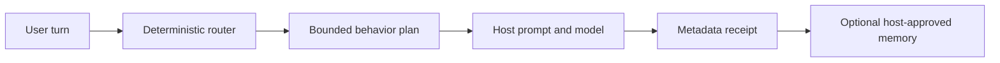

# Humanlike


**Deterministic, provider-neutral behavior controls for conversational AI agents.**

[English](#english) · [Русский](#русский) · [Documentation](#documentation) · [License](#license)

> **Status: public beta (`0.2.0`), licensed under MIT.** The API and configuration schema may change before `1.0`. The core runtime is offline, uses only the Python standard library, and does not call an LLM or the network.



## English

Humanlike is a behavioral planning layer for AI agents. It classifies each turn, selects a social and cognitive mode, assembles bounded guidance, and returns privacy-aware metadata. The host remains responsible for model calls, tools, transport, output delivery, transcript retention, and policy enforcement.

### What's new in 0.2.0

- **Consented personal memory.** Save explicitly stated preferences, goals and interests in the existing SQLite ledger, with source evidence and retrieval on later turns. Capture is off by default and requires the owner's consent and host-side authorization.
- **Changes without losing meaning.** Separate confirmation, a changed preference, correction of an incorrect record, and an unresolved contradiction. Domain and condition keep context-specific preferences separate; stale or repeated events cannot silently replace newer knowledge.
- **Owner controls and safe forgetting.** Inspect, correct, forget a fact's version history, or disable memory. No-save is checked before extraction and before persistence. Revocation and replay guards reject late results after forgetting or disabling, including after the ledger is reopened.
- **Bounded conversation continuity.** Recover references to an earlier artifact and actual past tool outcomes from host-authorized history for continuation requests. Unrelated requests, quoted cues and weak matches do not reactivate an old task; the canonical conversation is not rewritten.
- **Explicit host integration.** `PersonalMemory`, `AuthorizedHost` and `HermesAdapter.prepare_authorized(...)` provide the new integration path. Updating the stock plugin or enabling the legacy ledger does not activate personal capture. No mandatory cloud service, model or third-party runtime dependency is added.
- **Runnable examples and regression coverage.** A synthetic end-to-end example exercises persistence, reopening, correction, forgetting, no-save and context recall. Added tests cover authorization, replay, concurrent revocation, migration compatibility and installed-package behavior. The integration guide is available in English and Russian.

**Limits remain explicit:** capture currently uses English command words with Unicode values, not free-form extraction from ordinary conversation. Durable memory remains POSIX-only and unencrypted; forgetting does not erase host/provider transcripts or backups. Model answer-quality A/B is **NOT_RUN**: these functional additions are not evidence of more natural LLM answers.

Start with the [EN/RU integration guide](docs/PERSONAL_MEMORY.md), the [runnable synthetic example](examples/consented_memory.py), and the [bilingual 0.2.0 changelog](CHANGELOG.md#020---2026-11-05).

### What it provides

- Deterministic RU/EN routing across cognitive modes and social moves.
- Bounded context plans with mandatory truth and privacy guidance.
- Persona anchoring, repetition control, calibrated stance, and drift signals.
- Optional evidence-aware SQLite memory behind explicit host-controlled consent.
- Opt-in explicit personal-memory capture, correction/forget/revocation controls, and bounded conversation references through an authenticated host API.
- A 40-case offline conformance suite for routing, privacy, context budgets, policy, disclosure, stance, memory, and drift.
- A reference Hermes directory plugin with `pre_llm_call`, `transform_llm_output`, `post_llm_call`, and `on_session_finalize` hooks.
- Stable JSON CLI commands: `route`, `doctor`, and `eval`.

### What it is not

Humanlike is not a model, chatbot UI, autonomous agent host, network service, or complete model-safety system. It does not make an AI biologically human, hide AI identity, or control data already copied into a host or provider transcript.

### Quickstart

Requirements: Git and Python 3.11 or newer. Linux and macOS support the complete stack. Native Windows supports the core runtime, CLI, hardened read-only profile loading, read-only conversation references, and the memory-off Hermes plugin. The optional SQLite memory ledger remains POSIX-only in `0.2.x`.

Linux and macOS:

```bash
git clone https://github.com/AlekseiUL/humanlike.git
cd humanlike
python3 -m venv .venv
source .venv/bin/activate
python -m pip install .
```

Native Windows (PowerShell):

```powershell
git clone https://github.com/AlekseiUL/humanlike.git
Set-Location humanlike
py -3.11 -m venv .venv
.\.venv\Scripts\Activate.ps1
python -m pip install .
humanlike eval
humanlike doctor --config examples\hermes-humanlike\humanlike.toml
```

Run the first deterministic route:

```bash
humanlike route --text "Rewrite this paragraph in a neutral tone." --locale en
```

Run the bundled offline conformance suite:

```bash
humanlike eval
```

Validate the included Hermes reference profile:

```bash
chmod -R go-w examples/hermes-humanlike
humanlike doctor --config examples/hermes-humanlike/humanlike.toml
```

The hardened profile loader intentionally rejects group- or world-writable profile files and directories. The `chmod` step keeps the quickstart working in environments whose default `umask` is `0002`.

Each command prints one JSON object. Exit status `0` means success; validation errors use exit status `2`; `humanlike eval` uses exit status `1` when a declared expectation fails.

### Python API

```python
from pathlib import Path

from humanlike_agent import HumanlikeRuntime, Persona, RuntimeConfig, TurnInput

profile = Path("examples/hermes-humanlike").resolve()
persona = Persona.load(profile / "SOUL.md", allowed_root=profile)
runtime = HumanlikeRuntime(RuntimeConfig("example-profile"), persona)

plan = runtime.prepare(
    TurnInput(
        text="Give me three distinct approaches.",
        turn_id="turn-1",
        session_id="session-1",
        locale="en",
    )
)
print(plan.render_context())
```

The host calls its model and reports bounded outcome metadata through `runtime.observe(...)`. See [Architecture](docs/ARCHITECTURE.md) for the full lifecycle and trust boundary.

### Hermes integration

Install the package into Hermes' own Python environment, validate it, and then enable its official plugin entry point. Pin a reviewed commit in production:

```bash
HERMES_PYTHON="$(dirname "$(command -v hermes)")/python"
uv pip install --python "$HERMES_PYTHON" \
  "git+https://github.com/AlekseiUL/humanlike.git@<40-character-commit-sha>"
hermes plugins enable humanlike-agent-kit --no-allow-tool-override
hermes plugins show humanlike-agent-kit
```

Start a new Hermes session after enabling it. The full source tree contains adversarial safety fixtures, so direct directory-plugin installation is intentionally not used. See [Hermes installation](docs/HERMES_INSTALL.md) for details, health checks, rollback, and removal. Compatibility is documented in [Compatibility](docs/COMPATIBILITY.md).

Memory is disabled by default. Enabling it requires `memory_enabled = true`, `acknowledge_host_context_persistence = true`, and a relative `state_path`. The runtime cannot delete copies already retained by a host or model provider.

Those TOML settings configure the legacy ledger, **not automatic personal capture**.
For the new consented pipeline, bind `PersonalMemory` and `AuthorizedHost` in trusted
host code and explicitly call `enable()`. See the [EN/RU integration guide](docs/PERSONAL_MEMORY.md)
and run `python examples/consented_memory.py` after installation. It demonstrates
real persistence/reopen/correction/forget and artifact/tool-reference recall using
only synthetic data. The capture grammar is explicit, not free-form psychological
inference. Model answer-quality A/B is **NOT_RUN**; no naturalness improvement is claimed.

### Development

```bash
uv sync --locked --all-extras
uv run pytest -q
uv run ruff check .
uv run python scripts/privacy_gate.py .
```

The installed runtime has no third-party Python dependencies. Development, build, CI, and integration references are documented in [Acknowledgements](ACKNOWLEDGEMENTS.md).

---

## Русский

Humanlike — публичная бета-библиотека под лицензией MIT. Это детерминированный поведенческий слой для ИИ-агентов: он определяет тип запроса и способ ответа, собирает ограниченный контекст и возвращает метаданные с учётом приватности. Вызов модели, инструменты, доставка ответа, хранение переписки и соблюдение политик остаются на стороне основной системы.

### Что нового в 0.2.0

- **Персональная память по согласию.** Явно указанные предпочтения, цели и интересы сохраняются в существующем SQLite-хранилище со ссылками на источники и могут использоваться в следующих репликах. Запись по умолчанию выключена: нужны согласие владельца и проверка прав на стороне основной системы.
- **Различение смысла изменений.** Подтверждение, новое предпочтение, исправление ошибочной записи и неразрешённое противоречие обрабатываются отдельно. Предметная область и условие разделяют контекстные предпочтения; устаревшее или повторное событие не может незаметно заменить более свежие сведения.
- **Управление памятью и безопасное забывание.** Можно просмотреть записи, исправить их, забыть всю историю выбранного факта или отключить память. Запрет сохранения проверяется до извлечения и перед записью. Отзыв разрешения и защита от повторов отклоняют запоздавшие результаты после забывания или отключения — в том числе после повторного открытия хранилища.
- **Контекст продолжения разговора.** По запросу на продолжение библиотека возвращает ограниченные ссылки на прежний материал и реальные результаты инструментов из истории, доступ к которой разрешила основная система. Несвязанные запросы, цитаты и слабые совпадения не возобновляют старую задачу; исходная переписка не переписывается.
- **Явное подключение к основной системе.** Новый путь интеграции использует `PersonalMemory`, `AuthorizedHost` и `HermesAdapter.prepare_authorized(...)`. Обновление обычного плагина или включение прежнего хранилища не запускает персональный захват. Обязательные облачные сервисы, модели и сторонние runtime-зависимости не добавлены.
- **Исполняемый пример и проверки регрессий.** Сквозной пример на вымышленных данных проверяет сохранение, повторное открытие, исправление, забывание, запрет записи и восстановление контекста. Новые тесты покрывают права доступа, повторы, отзыв разрешения во время обработки, совместимость хранилища и работу установленного пакета. Инструкция по интеграции доступна на английском и русском.

**Ограничения указаны прямо:** запись пока использует английские командные слова со значениями Unicode, а не свободное извлечение фактов из обычной беседы. Постоянная память остаётся POSIX-only и не шифруется; забывание не удаляет переписку и резервные копии основной системы или провайдера. Слепое сравнение качества ответов модели — **NOT_RUN**: новые функции сами по себе не доказывают, что LLM стала общаться естественнее.

Начните с [инструкции EN/RU](docs/PERSONAL_MEMORY.md), [исполняемого примера на вымышленных данных](examples/consented_memory.py) и [двуязычной истории изменений 0.2.0](CHANGELOG.md#020---2026-11-05).

### Что умеет

- Маршрутизирует русские и английские запросы без вызова модели.
- Формирует ограниченный план ответа с правилами честности и приватности.
- Удерживает персону, снижает повторы, отслеживает позицию и поведенческий дрейф.
- Поддерживает опциональную SQLite-память только с явным согласием основной системы.
- Даёт управляемый захват явно указанных предпочтений, исправление, забывание и ограниченное восстановление контекста через проверенный host API.
- Запускает офлайн-проверку из 40 кейсов.
- Даёт эталонный адаптер для Hermes и JSON CLI-команды `route`, `doctor`, `eval`.

### Чего не делает

Это не модель, не интерфейс чата, не автономный агент и не универсальный фильтр безопасности. Kit не скрывает природу ИИ и не может удалить данные, которые уже сохранил хост или провайдер модели.

### Быстрый старт

Нужны Git и Python 3.11 или новее. Linux и macOS поддерживают полный стек. В нативном Windows работают основной runtime, CLI, защищённая загрузка профиля, чтение переданного контекста и Hermes-плагин с выключенной памятью. Опциональная SQLite-память в ветке `0.2.x` остаётся POSIX-only.

Linux и macOS:

```bash
git clone https://github.com/AlekseiUL/humanlike.git
cd humanlike
python3 -m venv .venv
source .venv/bin/activate
python -m pip install .
```

Нативный Windows (PowerShell):

```powershell
git clone https://github.com/AlekseiUL/humanlike.git
Set-Location humanlike
py -3.11 -m venv .venv
.\.venv\Scripts\Activate.ps1
python -m pip install .
humanlike eval
humanlike doctor --config examples\hermes-humanlike\humanlike.toml
```

Проверка одного запроса:

```bash
humanlike route --text "Перепиши этот абзац нейтрально." --locale ru
```

Офлайн-тесты поведения:

```bash
humanlike eval
```

Проверка примера профиля Hermes:

```bash
chmod -R go-w examples/hermes-humanlike
humanlike doctor --config examples/hermes-humanlike/humanlike.toml
```

Защищённый загрузчик намеренно отклоняет файлы и каталоги профиля с правом записи для группы или остальных пользователей. Команда `chmod` нужна в окружениях с `umask 0002`.

Каждая команда печатает один JSON-объект. Код завершения `0` означает успех, `2` — ошибку входных данных или конфигурации, а `humanlike eval` возвращает `1`, если хотя бы одна заявленная проверка не пройдена.

### Интеграция и память

Установите пакет в рабочую Python-среду Hermes, проверьте его и затем включите официальную точку подключения. Для рабочего использования закрепите проверенный коммит:

```bash
HERMES_PYTHON="$(dirname "$(command -v hermes)")/python"
uv pip install --python "$HERMES_PYTHON" \
  "git+https://github.com/AlekseiUL/humanlike.git@<40-character-commit-sha>"
hermes plugins enable humanlike-agent-kit --no-allow-tool-override
hermes plugins show humanlike-agent-kit
```

После включения начните новую сессию Hermes. В исходниках есть провокационные данные для тестов безопасности, поэтому прямая установка всего репозитория как directory-плагина намеренно не используется. Проверка, откат и удаление описаны в [инструкции по установке](docs/HERMES_INSTALL.md).

Память по умолчанию выключена. Для включения нужны `memory_enabled = true`, `acknowledge_host_context_persistence = true` и относительный `state_path`. Это осознанное ограничение: библиотека не управляет копиями данных в основной системе или у провайдера модели.

Эти TOML-настройки включают прежнее хранилище, **не автоматический захват личных фактов**.
Новый цикл требует `PersonalMemory`, проверенного `AuthorizedHost` и явного `enable()`.
[Инструкция EN/RU](docs/PERSONAL_MEMORY.md) описывает права, команды и ограничения;
`python examples/consented_memory.py` проверяет сохранение, повторное открытие,
исправление, забывание и контекст на синтетических данных. Свободное извлечение
личности из речи не заявляется. Слепое модельное A/B — **NOT_RUN**; улучшение
естественности ответов не доказано.

## Documentation

- [Architecture / Архитектура](docs/ARCHITECTURE.md)
- [Privacy / Приватность](docs/PRIVACY.md)
- [Consented memory and conversation context / Память и контекст](docs/PERSONAL_MEMORY.md)
- [Compatibility / Совместимость](docs/COMPATIBILITY.md)
- [Hermes installation / Установка в Hermes](docs/HERMES_INSTALL.md)
- [Threat model / Модель угроз](docs/THREAT_MODEL.md)
- [Security policy](SECURITY.md)
- [Contributing](CONTRIBUTING.md)
- [Acknowledgements and third-party tooling](ACKNOWLEDGEMENTS.md)
- [Changelog](CHANGELOG.md)

## Author and community

Created by **Aleksei Ulyanov**.

- [YouTube](https://youtube.com/@alekseiulianov)
- [Telegram: Sprut AI](https://t.me/Sprut_AI)
- [Telegram community chat](https://t.me/+eH-qNIDmud8zNDZi)
- [AI Операционка](https://t.me/tribute/app?startapp=sJyg)

## License

Humanlike is released under the [MIT License](LICENSE). The bundled foundation pack is included under the same MIT terms. External tools and projects referenced during development are listed in [ACKNOWLEDGEMENTS.md](ACKNOWLEDGEMENTS.md); their own licenses continue to apply.
